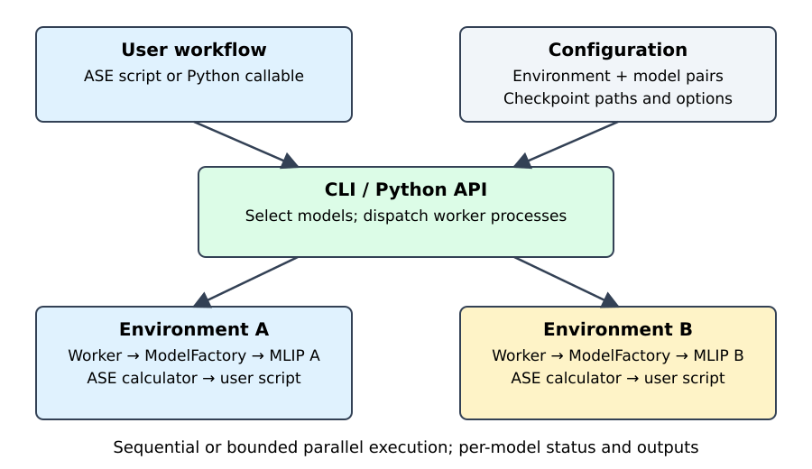

# Summary

Density Functional Theory (DFT) is a fundamental tool of computational materials science, providing quantum-mechanical accuracy for predicting structural, electronic, and thermodynamic properties at the atomic scale. However, its computational cost-scaling with the number of electrons-limits its applicability to relatively small systems and short timescales, restricting its use in simulations of complex materials, interfaces, and dynamical processes.

Machine Learning Interatomic Potentials (MLIPs) have emerged as a powerful alternative, enabling near ab initio accuracy at a fraction of the computational cost by learning the potential energy surface from DFT reference data [@kozinsky_2022; @mlips_practical_guide]. By scaling with the number of atoms rather than electrons, MLIPs allow simulations of larger systems, longer timescales, and more diverse structural environments [@focassio_2024]. This has expanded the scope of atomistic modeling to problems such as phase transformations, defect dynamics, and biomolecule–material interactions.

However, the rapid growth of MLIP models - spanning different architectures, training datasets, and software ecosystems - has created a fragmented landscape, where models are often tied to incompatible dependencies and heterogeneous interfaces. This makes reproducible benchmarking and systematic comparison across models difficult in practice. IP-Orch addresses this challenge by providing a lightweight orchestration layer that enables consistent execution of multiple MLIPs across isolated environments, facilitating transparent and reproducible side-by-side evaluation within a unified ASE-based workflow.

# Statement of need

`IP-Orch` [@iporch] is a Python package for orchestrating the usage of multiple Machine Learning Interatomic Potentials. With the growth of multiple models, different architectures (e.g., equivariant Graph Neural Networks, message passing, transformers) and datasets (e.g., Materials Project, OC20, custom trajectories) have been used for training. As a result, this scenario led to incompatible environments (PyTorch/JAX/CUDA) and inconsistent APIs, making side‑by‑side evaluation cumbersome and error‑prone. `IP‑Orch` addresses this gap with a thin, ASE‑centric orchestration layer that standardizes execution across models while preserving isolated software environments.

By configuring the package in a default environment with its respective interpreter (Venv or Conda), it searches for common keywords of the current MLIPs that have already been released in Matbench Discovery [@matbench-paper]. Users can register and validate model aliases, inspect supported model families, and execute workflows either from the command-line interface or through a programmatic Python API. `IP-Orch` has already been used for the development of different internal benchmarks, both with API retrieval and local dataset, and can now be used as a lightweight alternative to orchestrate multiple models by different communities interested in working with Machine Learning Interatomic Potentials.

# State of the field

Janus-Core provides ASE-based calculation workflows including single points,
optimization, molecular dynamics and phonons [@janus_core]. Rootstock provides
an ASE-compatible interface to MLIPs hosted in separate environments on HPC
systems, including integration with LAMMPS [@rootstock]. ASE itself supplies the
calculator interface and simulation tools [@ase-paper].

IP-Orch addresses the narrower task of dispatching an existing user script into
locally managed Python environments. The scientific workflow stays in the user
script rather than a new recipe implementation. Contributing another calculator
to a workflow package would not alone supply this interpreter-selection layer.
Rootstock already addresses dependency isolation; IP-Orch's distinction is its
local script dispatch and environment registration, not exclusive ownership of
that idea. No measured speed advantage over these alternatives is claimed.

# Software design

IP-Orch is designed to run the same user-defined ASE script across multiple models and environments in a simple and reproducible way. It follows three principles: (1) orchestrate rather than prescribe workflows; (2) rely on established tools such as the Atomic Simulation Environment (ASE) [@ase-paper] while remaining environment-agnostic; and (3) execute directly inside each target environment, using subprocesses without a persistent model server.

<!--  -->

This is implemented through a lightweight and modular architecture, as shown in Figure \ref{fig:arch}. A central `ModelFactory` creates ASE calculators from simple aliases, while the command-line interface and the `IPOrch` Python API share the same execution layer for environment discovery, model selection, and execution. During runtime, IP-Orch iterates over selected (environment, model) pairs and runs the user workflow inside each target environment using either the environment's Python executable (for local virtual environments) or `conda run` (for named Conda environments), ensuring isolation and avoiding dependency conflicts. Execution can be sequential or concurrent across selected pairs through a bounded parallel worker pool. The worker process also applies runtime safeguards such as model-alias validation, path-based virtual environment resolution, and notebook-safe subprocess settings. By delegating performance to the underlying MLIPs, IP-Orch focuses on providing a transparent and low-friction framework for reproducible benchmarking and comparison across models.

## Reference energy correction

IP-Orch can apply optional post-processing corrections to the energy returned by a MLIP. Let $E_{\mathrm{mlip}}$ be the model energy for a structure with $N$ atoms and composition $\{n_\alpha\}$, where $n_\alpha$ is the number of atoms of element $\alpha$.

**Linear correction.** When coefficients $a$ and $b$ are provided, IP-Orch first applies an optional linear transformation. In total-energy mode,

$$
E_{\mathrm{lin}} = a E_{\mathrm{mlip}} + b .
$$

In per-atom mode, the same transformation is applied to $E_{\mathrm{mlip}}/N$ and then scaled back to the total energy,

$$
E_{\mathrm{lin}} = N\left(a\frac{E_{\mathrm{mlip}}}{N} + b\right) = aE_{\mathrm{mlip}} + bN .
$$

If no linear parameters are provided, $E_{\mathrm{lin}} = E_{\mathrm{mlip}}$.

**Atomic reference correction.** Absolute MLIP energies can differ by element-dependent offsets. IP-Orch removes these offsets using one reference energy per element, $E_{\mathrm{ref}}(\alpha)$. These values can either be computed with the same MLIP from isolated atoms in a large non-periodic box,

$$
E_{\mathrm{ref}}(\alpha) = E_{\mathrm{mlip}}(\text{isolated atom of } \alpha),
$$

or loaded from a precomputed reference table when isolated-atom calculations are not desired. For a structure with composition $\{n_\alpha\}$, the reference shift is

$$
\Delta E_{\mathrm{ref}} = \sum_{\alpha} n_\alpha E_{\mathrm{ref}}(\alpha),
$$

and the corrected energy reported to the user is

$$
E_{\mathrm{corr}} = E_{\mathrm{lin}} - \Delta E_{\mathrm{ref}}.
$$

If the atomic reference correction is not enabled, $\Delta E_{\mathrm{ref}} = 0$ and $E_{\mathrm{corr}} = E_{\mathrm{lin}}$.

Subprocess isolation permits incompatible backend dependencies but duplicates
installations and incurs interpreter startup and model-loading costs. It does
not reserve GPU memory or provide a cluster scheduler. Parallel execution is
useful only when memory permits concurrent model instances; sequential execution
reduces peak memory demand. User scripts own their output protocol, so a shared
CSV requires explicit synchronization. The benchmark writes independent JSON
records instead. Linear energy transformations scale forces and stress by the
same coefficient; constant composition-dependent offsets have zero derivatives.

# Research impact statement

The committed `examples/surfaces_benchmark.ipynb` records a completed comparison
of bulk, slab and surface energies against DFT using seven MLIPs, dispatched by
IP-Orch. Its saved outputs report surface-energy RMSE values of 0.3521 J/m²
for MACE-MP, 0.09692 J/m² for MACE-MPA-0, and 0.1013 J/m² for ORB-v3.
IP-Orch supplied environment selection and reused the same comparison logic
across backends. These are recorded notebook outputs, not independently
reproduced measurements. Extracted logs are provided in
`examples/benchmark/notebook_evidence.json`. The notebook reports 20 surface
and 20 DFT cache files; input datasets, full backend versions and DFT settings
must be archived before its numerical claims can be independently audited.
No publication enabled by IP-Orch or independent adoption is established by
these artifacts. A smaller silicon example in `examples/benchmark` supplies
portable input and structured output for integration validation; it does not
replace the missing surface dataset.

# AI usage disclosure

OpenAI Codex assisted with audit fixes, tests, documentation and revision of
this manuscript. Changes were checked using Ruff, pytest and package builds;
these automated checks do not constitute human scientific validation.
[NEEDS EVIDENCE: authors must record the exact model/tool version, disclose any
prior AI use, and describe their human review before submission.]

# Acknowledgements

[NEEDS EVIDENCE: authors must confirm funding agencies, grant numbers and
relevant contributions. No funding or acknowledgements are inferred.]

# References
